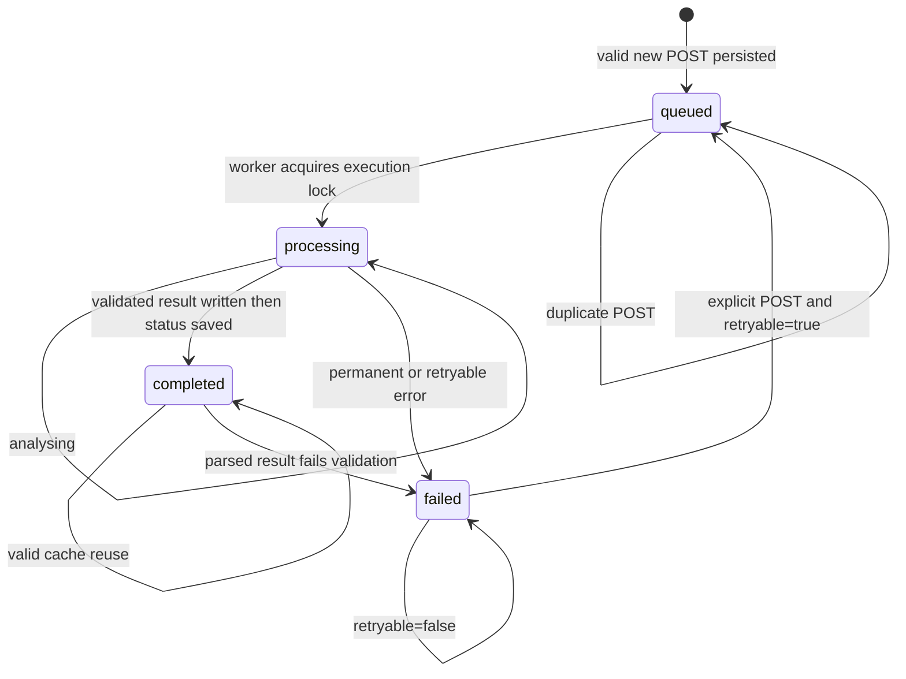

# State machine, concurrency and recovery audit

Main: origin/main `ce0b07becfb0952992fa002f48fdbb76cfe78a1d`. Resumed audit: frontend feat/frontend-geographic-ux `c8813a89193c66843f7f6bcb50e2bf1ace1b500d` (F2), backend feat/arbitrary-aoi-api `731819a5d2eeacd4838d08b3e7f466135f5c8ac4` (B2). Historical F/B defects remain scoped to their original commits in RELEASE_AUDIT.md; the reconciliation there supersedes claims about the latest branches. No application code changed.

## Actual B2 job lifecycle

Derived from src/pipeline/aoi_job.py:118,195,233,327,360; job_api.py:76; job_worker.py:185. Stages are fields on processing, not separate job status enum values.

There is no publishing state, automatic retry of failed jobs, remote-task-expired transition, or automatic resolution of ambiguous submission. Startup scans queued/processing files and resumes them; it does not reset all failed jobs. A 2-hour stale rule in create_or_reuse_job is not the worker's startup mechanism. Completed-state corruption can escape before validation, so the diagram does not invent a clean corrupt→failed transition for all cases (A11).

## Persistence, ownership and NASA states

| Machine | Implemented states/transitions | Failure/recovery boundary |
|---|---|---|
| HTTP admission | auth/origin/body checks → admission lock → quota reserve → request route | 401/403/413/429 before dispatch. Quota reservation can overcount after crash by design. JSON corruption in any job during pending-count scan causes503 for unrelated new work (A27). |
| Queue | job file queued/processing → serial scanner | Global worker file lock plus per-job execution lock; no GitHub queue in B2 live runtime. A missed wake is recovered by scanning. Sorted filenames are not FIFO fairness. |
| Duplicate submit | per-job lock → existing status reused | Same normalized geometry/dates/product/QA share one ID. Completed/pending duplicates do not consume new-work quota. Distinct windows differ even if monthly output calendar is the same. |
| NASA submission | no checkpoint → persisted intent(task_id=null) → POST → persisted confirmed ID → status ID | Crash before intent safe; intent without confirmed ID blocks automatic resubmit. Crash between NASA acceptance and ID checkpoint requires operator reconciliation, intentionally. |
| Remote task | submitted/pending → polling → done or error/expired | 30-minute polling timeout returns processing/waiting; worker waits300s then resumes saved ID. Error/expired is generally failed/retryable and retains same ID, causing A12 retry loop. |
| Downloads | missing → temporary bytes → rename → present | Existing files skipped by existence only; corrupt cache persists. Partial suffixes can enter raster glob (A20). No autonomous integrity repair. |
| QA/analysis | land check → fetch → status check → CSV/QA validation → stats → result validation | Low coverage/permanent known errors fail; unknown errors retryable. Source manifest identity is recorded but not checked against request (A09). |
| Result publication | put_result → completed status → HTTP GET owning job/result | GET validates completed ownership and scientific identity. Crash between result and status leaves orphan file; resumed computation can overwrite it, GET does not serve it prematurely. |
| Atomic storage | unique tempfile, file fsync, replace, directory fsync | Improved from shared .tmp collision. History/status/result are separate writes, not a transaction. Missing disk/permissions return503/worker errors; no demonstrated automatic repair of corrupt files. |
| Host restart | OS releases locks; new worker scans queued/processing | Requires same persistent volume and configured single-host topology. Empty ephemeral filesystem loses work. No cross-host replication/backup restoration was verified. |

B2 worker consumes one task serially. One NASA task pending indefinitely can occupy repeated30-minute windows; queued jobs wait behind this work but are revisited by the scanner. There is no task-age deadline or user cancellation. This is a latency/operational limitation, not proof that every pending job is orphaned. A bounded error/reconciliation policy is needed for a public service.

Execution locks protect the configured LocalJobStore path across CLI and runtime consumers. Tests using a fake store without locked() do not establish that this improved production path duplicates submissions; historical A08 remains valid on main/old B but is addressed in B2. Admission locks and state locks have different purposes. Deployment must preserve one shared filesystem and one configured service; deploying replicas on different volumes defeats the model.

## Frontend state and asynchronous ownership

F2 App.tsx:40–245 uses separate example and analysis objects and display=example/selection. Selection draft edits invalidate epoch, confirmation, job and analysis. Confirmation allows submission; coordinate/date edits invalidate pending work. Example loads only set example. This removes the previous catalogue→activeResult overwrite path A03 by construction, though no composed hosted race test was performed.

Submission: unconfirmed → confirmed → submitting → queued/processing → completed result or error. Polling is sequential setTimeout4s with15s network timeout, epoch/cancellation checks, and stops on error. Selection changes ignore stale responses. Poll failures leave a truthful stopped state; they do not manufacture completion. Browser refresh restores selection draft/confirmation through localStorage but not active job/result polling. An explicit POST can recover the durable backend job; an automatic browser resume flow is not implemented.

F2 verifies response request bbox/dates/product against submitted fields and poll request consistency. Its completed() check validates result centre and NDVI variable only. It does not bind result region/job ID or requested month window. A same-centre baseline result for a 2002-02 start is accepted as completed (A02, new browser reproduction). Same-centre different-extent data is likewise not distinguishable from result metadata alone; enforce job identity and source lineage, not just location centre.

Example versus selection is now explicit. Static mode keeps live submission disabled without a configured API base. No styling/theme critique is required to close these integrity defects.

## Actions and deployment state

Main manual Actions workflow checkpoint/push issues are A14. B/B2 manual workflow has one concurrency group per branch. It is explicitly not the live queue. Default GitHub concurrency has one running and one pending; another pending run replaces the previous pending run even with cancel-in-progress=false. See [official concurrency documentation](https://docs.github.com/en/actions/how-tos/write-workflows/choose-when-workflows-run/control-workflow-concurrency). A13 applies to exposing that manual workflow as a public queue, not to B2's new on-host scanner.

A repository result commit is not a Vercel publication. Static release gate permits only the reviewed baseline. B2 live HTTP result route avoids a Vercel rebuild if actually deployed and reachable. No host/disk/DNS/HTTPS/service install or recorded deployed SHA was verified. Thus compute-completed→publicly-readable is proven locally only; A15 remains a production delivery gate.

## Required transition tests

Existing final B2 suite:183 passed; local cached Gunicorn smoke completed288 months. Additional independent probes confirm A09/A12/A27; F2 browser probe confirms A02. Retained logs are in evidence/ and reproduction scripts in probes/.

Still required: actual composed frontend auth/transport; public endpoint cold start/refresh; host crash immediately around NASA intent/confirmed-ID writes; disk-full and backup restoration; corrupt job/result quarantine; prolonged remote pending with multiple queued users; rate-limit interaction with4s polling; expired-task operator recovery; publication unavailable after completed; authenticated CORS against actual frontend origin. No live NASA or GitHub mutations were used to test these transitions.
